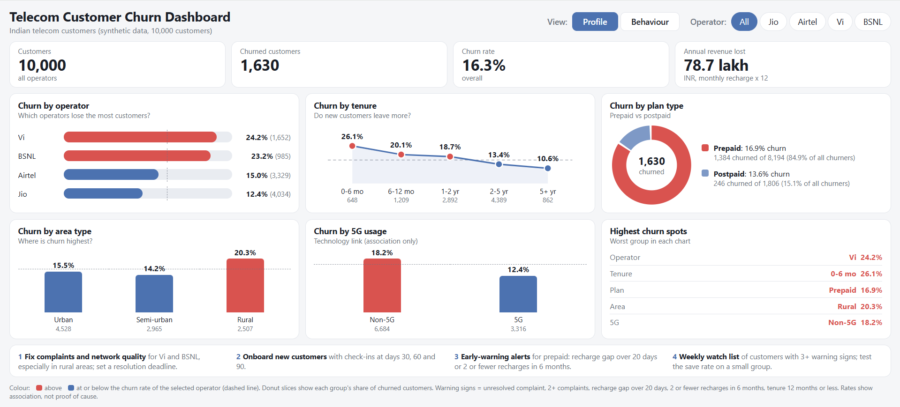
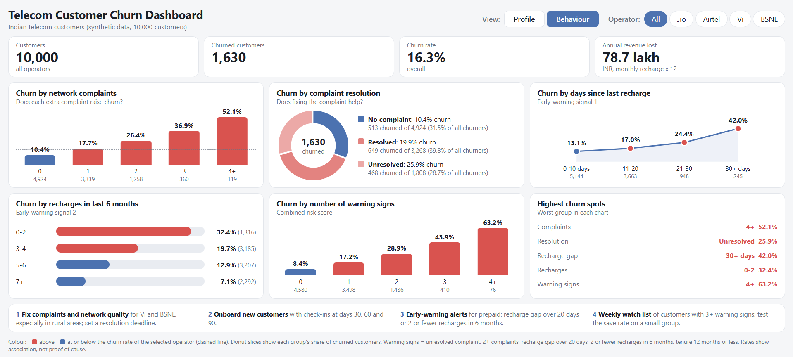
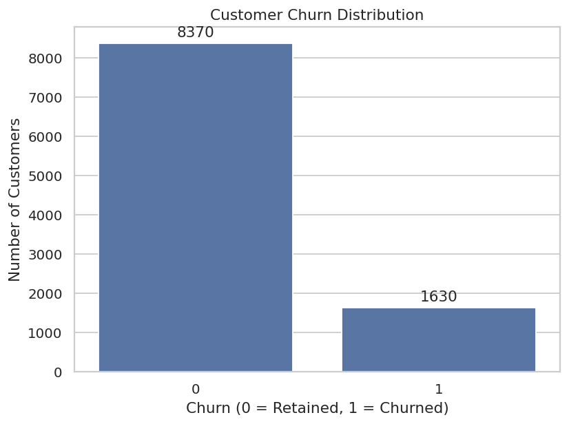
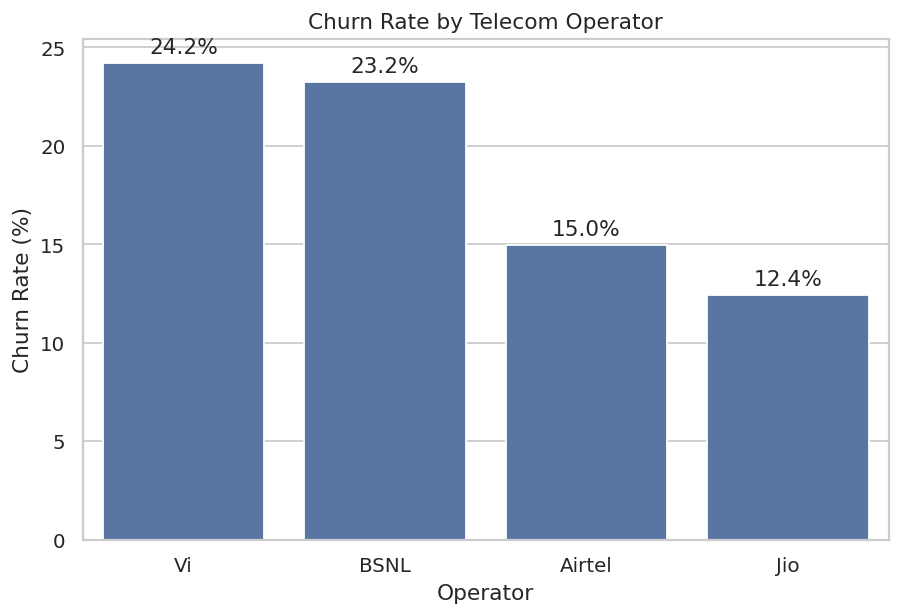
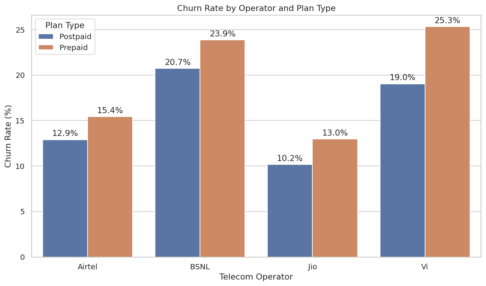
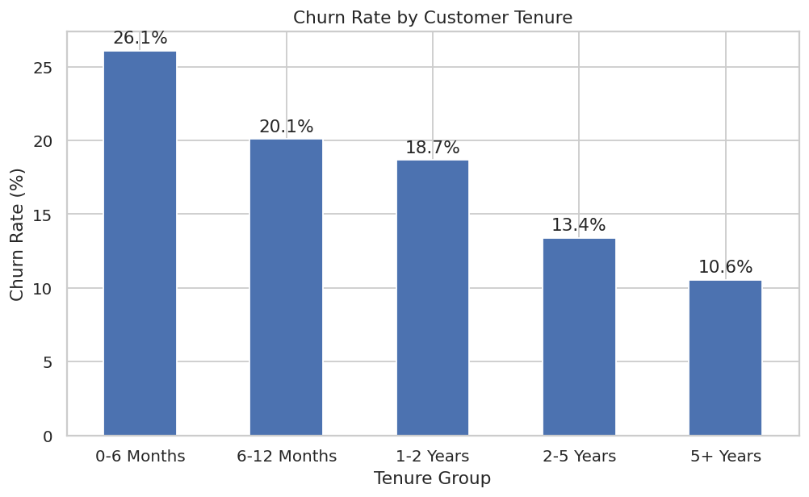
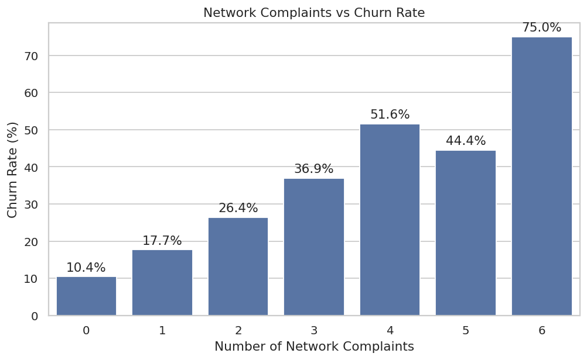
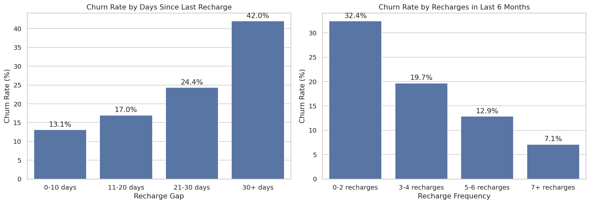
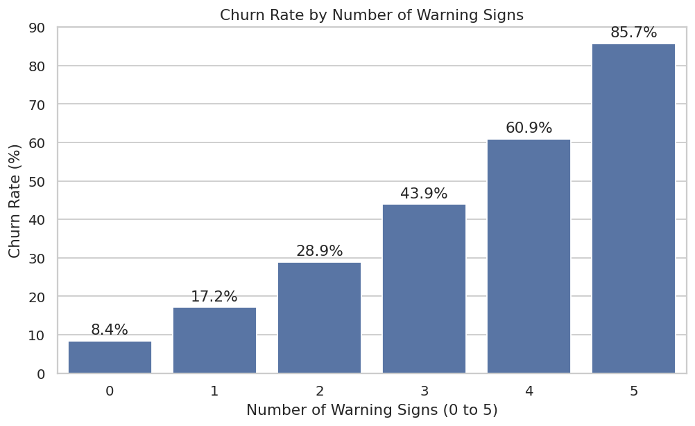

# 📡 Indian Telecom Customer Churn Analysis

**Why telecom customers leave and what to do about it: an end-to-end analysis of 10,000 customers across Jio, Airtel, Vi and BSNL.**

---

## 📌 Overview

This project is an end-to-end exploratory data analysis (EDA) in Python that finds **why customers leave** and recommends **what the company can do to keep them**. It cleans the data, answers **8 business questions** about operators, plans, tenure, complaints and recharge behaviour, and turns every finding into an action.

> **Data note:** the dataset is **synthetic** to practise the analysis workflow.

## 📊 Headline numbers

| Customers | Churned | Churn rate | Highest-churn operator | Riskiest segment |
|:---:|:---:|:---:|:---:|:---:|
| **10,000** | **1,630** | **16.3%** | **Vi (24.2%)** | **Vi prepaid, rural (34.4%)** |

## 🖥️ Interactive dashboard

A one-page dashboard built from the same analysis. It has two views, **Profile** (who the customers are) and **Behaviour** (what they do), and can be filtered by operator. It contains only aggregated figures. The dashboard groups "4 or more" complaints (and warning signs) into one bar, so those two bars differ slightly from the exact numbers in the notebook.

**Profile view**

**Behaviour view**

---

## Business problem

A telecom company is losing about 1 in 6 customers. The retention team needs to know:

1. What percentage of customers are churning?
2. Which operators have the highest churn?
3. Are prepaid customers more likely to churn than postpaid customers?
4. Does customer tenure influence churn?
5. Do network complaints increase churn?
6. Does recharge behaviour indicate a risk of churn?
7. Which customer segments are most likely to leave?
8. What can the company do to reduce churn?

## Key results at a glance

| Metric | Result |
|---|---|
| Customers analysed | 10,000 (after removing 40 duplicates) |
| Overall churn rate | **16.3%** (1,630 customers) |
| Highest-churn operators | Vi (24.2%), BSNL (23.2%) |
| Lowest-churn operator | Jio (12.4%) |
| Prepaid vs postpaid | 16.9% vs 13.6% |
| Churn in first 6 months | 26.1% (vs 10.6% after 5 years) |
| Customers with 4 complaints | 51.6% churn (vs 10.4% with none) |
| Riskiest segment | Vi prepaid in rural areas: 34.4% |

## Dataset

- **File:** `data/india_telecom_churn_synthetic.csv` (raw, 10,040 rows) and `data/india_telecom_churn_cleaned.csv` (cleaned, 10,000 rows)
- **Rows / columns:** 10,040 / 21 (raw)
- **Generated by:** `generate_dataset.py` (random seed 42), so the data is simulated and can be recreated
- **Target:** `churn` (1 = customer left, 0 = retained)

| Column | Description |
|---|---|
| `customer_id` | Unique customer ID |
| `operator` | Jio, Airtel, Vi or BSNL |
| `plan_type` | Prepaid or Postpaid |
| `age`, `gender` | Customer demographics |
| `circle`, `area_type` | State and urban / semi-urban / rural |
| `tenure_months` | Months with the operator |
| `monthly_recharge_inr` | Monthly recharge or bill amount in INR |
| `avg_data_gb`, `avg_call_minutes`, `sms_sent` | Usage |
| `device_type`, `is_5g_user` | Device and 5G usage |
| `payment_mode` | UPI, Card, Net banking or Cash/Retailer |
| `network_complaints` | Number of network complaints |
| `customer_care_calls` | Calls made to customer care |
| `complaint_resolved` | Yes, No, or No complaint |
| `recharge_gap_days` | Days since last recharge |
| `num_recharges_6m` | Recharges in the last 6 months |
| `churn` | Target variable |

## Approach

1. **Inspection:** checked size, data types, missing values, duplicates and outliers.
2. **Cleaning:**

   | Issue | Rows | Action |
   |---|---|---|
   | Duplicate records | 40 | Removed |
   | Missing `avg_data_gb` | 203 | Filled with median |
   | Missing `customer_care_calls` | 166 | Filled with median |
   | Missing `age` | 81 | Filled with median |
   | Recharge placeholder of 9,999 INR | 12 | Replaced with the median of the same plan type |

3. **Analysis:** churn rates by operator, plan, tenure, complaints, recharge behaviour, area, 5G and payment mode, followed by correlation analysis.
4. **Segmentation:** combined operator, plan and area to find high-risk groups, and built a simple 5-point warning-sign score.
5. **Recommendations:** turned every finding into an action and a KPI.

## Findings and recommendations

### Q1. Overall churn
1,630 of 10,000 customers churned (**16.3%**). This is the baseline KPI.

### Q2. Which operators have the highest churn?
Vi (**24.2%**) and BSNL (**23.2%**) churn at almost twice the rate of Jio (**12.4%**). Airtel sits at 15.0%.

**Action:** audit network quality and complaint handling for Vi and BSNL, and run win-back and loyalty offers for their at-risk customers.

### Q3. Prepaid vs postpaid
Prepaid churn is higher (**16.9%** vs **13.6%**) for every operator. The operator matters more than the plan type: Vi postpaid (19.0%) churns more than Airtel prepaid (15.4%). The riskiest combination is **Vi prepaid (25.3%)**.

**Action:** promote auto-recharge (UPI AutoPay), long-validity plans and rewards for consecutive recharges, and offer eligible prepaid users a move to postpaid.

### Q4. Does tenure matter?
Yes. Churn falls from **26.1%** in the first 6 months to **10.6%** after 5 years.

**Action:** build a first-6-month onboarding program with check-ins at days 30, 60 and 90.

### Q5. Do network complaints increase churn?
Yes. Churn rises from **10.4%** (no complaints) to **51.6%** (four complaints). Customers with an unresolved complaint churn at **25.9%**, versus 19.9% when resolved. Even resolved complainers churn at nearly double the rate of customers with no complaint.

**Action:** set a complaint resolution SLA, treat the second complaint as an alert for proactive outreach, and follow up after every resolution.

### Q6. Does recharge behaviour signal risk?
Yes, strongly. Customers who go **more than 30 days** without recharging churn at **42.0%** (vs 13.1% for under 10 days). Customers with **2 or fewer recharges** in 6 months churn at **32.4%** (vs 7.1% for 7 or more). The recharge **amount** matters much less, so price alone is not the main driver.

**Action:** trigger an early-warning alert when the recharge gap passes 20 days or recharges drop to 2 or fewer in 6 months, and send a targeted offer before the customer leaves.

### Q7. Which segments are most likely to leave?
- **Rural customers:** 20.3% churn (urban 15.5%, semi-urban 14.2%).
- **Riskiest segments:** Vi prepaid in rural areas (**34.4%**) and BSNL prepaid in rural areas (**30.8%**).
- **5G users** churn less (12.4% vs 18.2%), but this is an association, not proof of cause.
- **Payment mode** has almost no effect (15.4% to 16.9%).

A simple score counts five warning signs (unresolved complaint, 2 or more complaints, recharge gap above 20 days, 2 or fewer recharges, tenure of 12 months or less). Churn climbs from **8.4%** with no signs to **43.9%** with three and **60.9%** with four.

**Action:** give the retention team a weekly watch list of customers with 3 or more warning signs (4.9% of customers, 46.9% churn), and focus rural network investment on Vi and BSNL prepaid areas.

### Q8. Priority recommendations
1. Fix complaint handling and network quality for Vi and BSNL, especially in rural areas.
2. Launch an onboarding program for the first 6 months.
3. Turn on recharge-gap early-warning alerts for prepaid customers.
4. Run the high-risk watch list and measure the save rate on a small test group.

**Revenue at risk (illustrative):** with annual revenue per customer taken as monthly recharge x 12, churned customers represent about **INR 78.7 lakh** a year (**15.9%** of all recharge revenue). If 25% of the churners in the 3+ warning-sign group were saved, about **INR 2.8 lakh** a year would be protected.

**Insights, actions and KPIs**

| # | Insight | Recommended action | KPI to track |
|---|---|---|---|
| 1 | Overall churn is 16.3% | Use as the baseline and report monthly by operator and segment | Monthly churn rate |
| 2 | Vi (24.2%) and BSNL (23.2%) lose the most customers | Network and service audit, win-back and loyalty offers | Churn rate by operator |
| 3 | Prepaid churn (16.9%) is above postpaid (13.6%) in every operator | Auto-recharge, long-validity plans, rewards, postpaid upgrade offers | Share of prepaid users on auto-recharge |
| 4 | First-6-month churn is 26.1% | Onboarding program with check-ins at days 30, 60 and 90 | 6-month churn rate |
| 5 | Churn rises from 10.4% to 51.6% as complaints go from 0 to 4 | Resolution SLA, outreach after the second complaint, follow-up after resolution | % complaints resolved on time; repeat complaints |
| 6 | Recharge gap above 30 days means 42.0% churn; 2 or fewer recharges means 32.4% | Early-warning alerts at a 20-day gap, reminders and targeted offers | Customers reactivated after alert |
| 7 | Rural churn is 20.3%; Vi and BSNL prepaid in rural areas reach 34.4% and 30.8% | Prioritise rural network coverage and affordability offers | Rural complaint rate and churn |
| 8 | Customers with 3+ warning signs churn at 46.9% | Weekly high-risk watch list for the retention team | Save rate in the high-risk group |
| 9 | Recharge amount and payment mode barely move churn | Avoid broad discounts; focus on service and engagement | Not applicable |

## Limitations

- The data is synthetic, so the relationships show the method, not real market behaviour.
- All findings are associations, not proof of cause and effect.
- The risk-score thresholds were chosen from the same data they are tested on, so the results are optimistic until validated on new data.
- There is no time dimension, so seasonality and trends cannot be studied.

## Tools

Python, pandas, NumPy, Matplotlib, Seaborn, Jupyter Notebook

## License

Released under the [MIT License](LICENSE).

## Author

**Harsh Kanaujiya** | [LinkedIn](https://www.linkedin.com/in/harshkanaujiya0207) | [GitHub](https://github.com/harshkanaujiya0207) | harshkanaujiya7860@gmail.com
